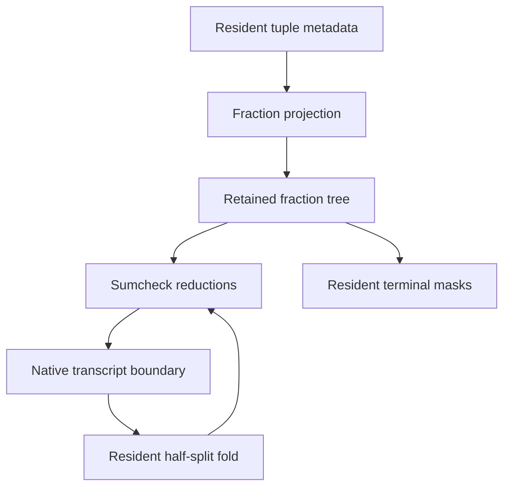
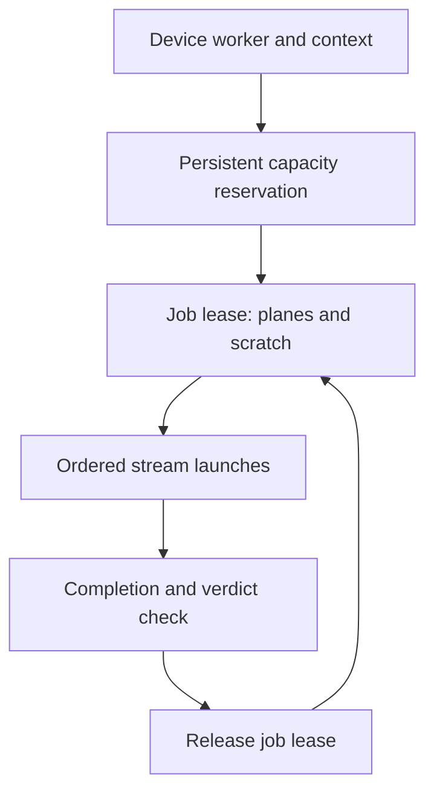

# RV64 resident CUDA numerical engine — first implementation

Base: PR310 `a7f484e34c266bf1a7d220d96502701794fa6d7c`.

The first delivery is the eight-coordinate OM31 lookup/GKR numerical engine,
with device-only input/output, context-owned allocations and stream ordering.
It is not yet the complete Ethereum CUDA prover. No CPU numerical fallback is
permitted. PR310's statement, transcript, v3 admission and security gates stand.

## Contract and cost hypothesis (before implementation)

The CPU route materializes or streams N (M31) and D (OM31), builds adjacent-pair
fraction trees, evaluates sumcheck at 0/2, and half-split folds them. Existing
CUDA arithmetic is four-coordinate QM31. Extending that arithmetic and retaining
all large arrays on the GPU removes round-by-round matrix transfers and permits
independent role instances to run concurrently. No speedup is asserted before
hardware parity and complete-block measurement.

Inputs are canonical base-field tuple planes/weights and eight-coordinate
challenges already resident in the existing CUDA context. Projection computes
`D = offset - sum(coefficient[j] * tuple[j])`; an explicit resident boolean active mask selects padding as the
native `(N=0,D=1)` facts, including interleaved padded lanes. Zero weight
alone is not padding. Invalid coordinates or poles set
a sticky device verdict. Tree construction uses `N'=N0*D1+N1*D0,D'=D0*D1`;
two levels can be fused. Numerators stay base-valued at the bottom and become
secure after the first tree/fold. All large secure arrays use coordinate-major
SoA, matching eight separate M31 coordinate polynomials.

Sumcheck reads adjacent children in two halves, evaluates the same fraction
polynomial at 0 and 2, weights by native EqEvals, and performs a deterministic
warp/block reduction. Its output is two OM31 values. It does not interpolate,
draw randomness or mutate a transcript. The caller's existing transcript and
polynomial-correction authority must consume these values in native order.
Half-split folds are disjoint ping-pong writes: adjacent-pair tree reduction
must never be mistaken for MLE folding.

Every launch validates the context's live allocation registry, lane and exact
plane bounds before enqueue. Output/input overlap is rejected. No launch
allocates, copies to/from host, waits on the host, uses a default stream or
changes the CUDA device. The owner creates the context/pool on its worker
thread, orders input readiness with existing dependency events and joins lanes
before publishing an output or releasing any allocation. Device verdicts must
be checked before admitting a result. Launch or async failure poisons the job;
partial results cannot be published or retried as valid.

Capacity is per device, never aggregate VRAM. A bounded multi-device scheduler
admits 2 or 4 distinct devices with observed free bytes and a safety reserve;
leases charge exact retained+scratch+input bytes until successful completion or
joined abort. It greedily chooses the least charged eligible device, permits
multiple independent jobs per device, and uses generation-tagged tickets to
reject stale/double completions. Topology requires no peer access: schedule
whole instances/shards locally, preserving their public order on assembly.
4090/5090 names are deployment intents, not memory or bandwidth assumptions.

Memory: base leaf N+D =36n bytes; one secure N+D level=64m bytes; a full
secure upper tree totals <64n bytes; half-split scratch <=32n bytes. Eq is
<=8n bytes and two reduction scratch banks are bounded by their block counts.
These are numerical-engine terms, not a bound for PCS/witness/recursion. The
integration planner accounts its own explicit buffers and rejects overflow.

Success gate: scalar/independent field and native Zig OM31/GKR parity, CUDA
sm_89 and sm_120 compilation, then real-device sanitizer and timing sweeps on
2/4 devices. Final performance gate is an unchanged-security full block plus
fresh receiver, including witness, commitments, DEEP/FRI and global closure.
Rollback on any numerical, order, custody or resource discrepancy.

## Research basis and remaining integration

- AntChain's [zkDTVM overview](https://openlabs-intl.antdigital.com/0x/Introducing-zkDTVM-A-GPU-Native-zkVM-Built-for-End-to-End-Acceleration)
  describes GPU-native trace/commit/sumcheck/opening/recursion. Its
  [v0.8 verifier release](https://github.com/AntChainOpenLabs/zkdtvm-wasm-stark-verifier)
  explicitly says the prover is not open source. Treat the architecture as a
  direction, not inspected proprietary kernels or a reproduced benchmark.
- ZisK [ProofMan](https://github.com/0xPolygonHermez/pil2-proofman) exposes GPU
  proving and scheduling. Pin inspected source links and revisions in the
  qualification report; do not import external code or change our protocol.
- Our existing context owns async pools, nonblocking lanes, dependency events
  and allocation validation; existing transforms/commitment kernels remain the
  reuse path for the eight-coordinate PCS stages.

Next: lower the actual RV64 metadata providers to resident tuple emission,
connect numerical calls to the generic GKR orchestration without duplicating
transcript logic, extend OM31 transcript/PCS/FRI/DEEP, port each admitted truth
provider and derive the new receiver roster. Full v3 GKR admission stays closed
until PR310's remaining authority adapters are qualified. Keep recursion and
certification separate.

## Inspected ZisK source (2026-11-02)

ProofMan revision `27b2fc20d52d8b8899291505c27e156c7cd8ef9c`:

- [`common/src/gpu_stream_layout.rs`](https://github.com/0xPolygonHermez/pil2-proofman/blob/27b2fc20d52d8b8899291505c27e156c7cd8ef9c/common/src/gpu_stream_layout.rs)
  sizes stream classes to heterogeneous AIR requirements. Our first scheduler
  charges each job's actual requested capacity rather than making every lane
  reserve the largest possible instance. It is a credit ledger, not a measured
  optimal policy; work estimates and measured scheduling weights come later.
- [`gpu_witness.hpp`](https://github.com/0xPolygonHermez/pil2-proofman/blob/27b2fc20d52d8b8899291505c27e156c7cd8ef9c/pil2-stark/src/starkpil/gpu_witness.hpp)
  provides enqueue-only witness fills into the commit slot. Our numerical ABI
  similarly accepts device planes, but real RV64 witness-to-commit lowering is
  still unimplemented. It must avoid uploading materialized host traces.
- [`cuda_graph_cache.cuh`](https://github.com/0xPolygonHermez/pil2-proofman/blob/27b2fc20d52d8b8899291505c27e156c7cd8ef9c/pil2-stark/src/utils/cuda_graph_cache.cuh)
  budgets graph memory and binds graph cache lifetime to stream ownership. Our
  first engine launches directly: the existing context rejects borrowed lanes
  during capture. Do not claim graph replay until that lifecycle is integrated
  explicitly and captured addresses/parameters have immutable custody.

No external source was copied. These sources supply design lessons, not a
same-security performance comparison or evidence of beating either prover.
