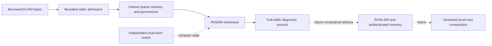
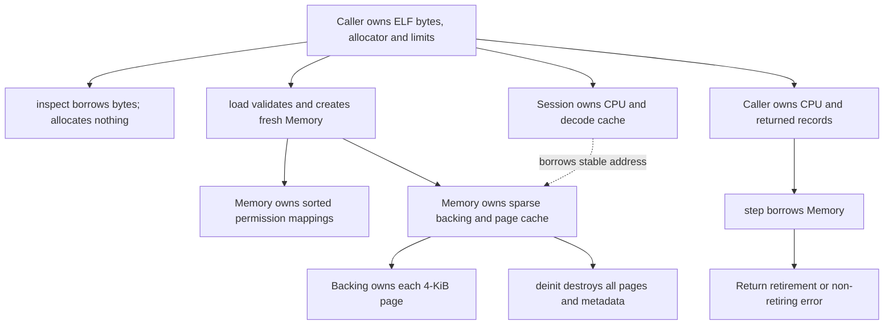

# RV64 frontend development contract

The first milestone is an execution frontend for current Rust OP guests.
RV64 has its own machine, decoder and diagnostic records inside the existing
RISC-V package. RV32 proof opcode identities, machine types and public statement
formats keep their meanings. The initial execution profile has no proving or
SP1 ABI capability.

The current motivating binary is the Ethereum range guest in OP Succinct
v4.9.3. Its ELF64 format requires a 64-bit loader, but ISA support alone does
not provide its runtime, witness I/O, allocator or patched cryptographic calls.

## Ownership and failure boundaries

`elf.inspect([]const u8, Limits)` returns an `Image` summary. `elf.load` returns
owned `Memory`, with no partial image escaping on failure. The ELF slice need
not survive the load. `Cpu.step(*Memory)` returns one `Retirement` by value.
No execution trace is accumulated unless the caller chooses to retain records.
All allocations are caller supplied except the standalone diagnostic tool's
explicit JSON arena and per-case page allocator.

The execution contract and exact rejection rules live beside the implementation
in [the RV64 README](../../src/frontends/riscv/rv64/README.md). Resource failures
and traps preserve architectural CPU and memory bytes. The foundation round
also rolls back unpublished pages on allocation failure. Cancellation is caller
controlled between steps or bounded batches.

## Work and resource model

The loader validates at most 256 program headers and copies file-backed load
bytes once. Overlap admission is O(S²) for S segments. Sparse pages give expected
O(1) backing lookup through a bounded page cache; permission lookup is O(log S)
with exact cached ranges. An instruction performs constant-size arithmetic
and at most one architectural load or store. Zero-filled BSS does not allocate
pages until written.

Default backing allocation is bounded to 65,536 pages (256 MiB), plus page-map,
transactional reservation and region metadata. At most 256 mappings are admitted
by default. Virtual mappings are independently limited to 256 MiB.
The diagnostic CLI limits input files to 32 MiB. JSON vector decoding retains
its bounded input corpus; per-case page allocations are freed immediately.
Execution uses one CPU thread, no GPU dispatch or synchronization, and no
background work. Compilation and ELF loading are cold setup; CPU/memory state
is reusable across steps.

This is compatibility development, with no throughput improvement claim. The
later cost hypothesis is that fewer RV64 guest instructions can offset wider
AIR rows. Test it using the same real OP block witness and public outputs on
RV32 and RV64, reporting instruction counts, field cells, lookup traffic,
resident/spooled bytes and complete verified proof latency. Execution-only
timings cannot establish that hypothesis.

## Foundation efficiency contract

The next execution milestone uses concrete RV64 types, with no parameterized
CPU, memory or arithmetic framework. Reuse the RV32 design lessons: cache by
fetched instruction word, retain architectural state across bounded segments,
reserve fallible resources before retirement, and canonicalize unused operands.

The current memory loop performs a hash lookup per byte and scans region lists
on each access. Predict fewer lookups with one page lookup per aligned access,
a bounded page cache, sorted mappings and exact cached permission ranges. Bulk
initialization should copy page-sized slices rather than look up every byte.
Steady-state mapped reads/writes and cached instruction retirement must allocate
nothing. Allocation failure must restore page inventory as well as bytes.

Measure the original source snapshot and the candidate with identical ReleaseFast
execution, mixed memory and bulk-load kernels, including final-state checksums.
Reject an optimization if correctness/oracle checks fail or paired median warm
execution regresses. Report cold allocations and bounded cache storage separately.
These measurements are execution diagnostics, never proving speedups.

CSP is the workload comparison target. Rebuild the pinned software SHA256,
Keccak, Poseidon2-M31 extension and secp256k1 guests for RV32IM and RV64IM with
the same Rust toolchain and flags, validate the same manifest-bound inputs and
outputs, and retain exact instruction counts. Report host execution measurements
with their runner/trace scope; RV32 proof preparation and RV64 execution alone
are different work. The bounded AIR now has small native proof fixtures; these do not yet establish
a paired CSP proving comparison. See [the AIR contract](rv64-air.md).

## Qualification sequence

1. Strict RV64IM decoder and retirement semantics, full-width memory, static
   ELF64 loading, negative tests and an independently compiled guest.
2. Pinned RV64 Sail and architectural execution/trap comparisons. The initial
   Unicorn 2.1.4 gate covers every retiring opcode but is not Sail authority.
3. Range-constrained arithmetic and register/memory relations, immutable
   program binding, adversarial witness tests and small complete native proofs.
4. Versioned boundaries and recursive verification, preserving full-width
   addresses and register values across every segment.
5. Current Kona source/runtime port, required crypto accelerators, exact real
   block public-output agreement, then representative proving benchmarks.

Review the decoder first, then memory and ELF bounds, then instruction
retirement and its tests. Review the diagnostic ABI and independent oracle
separately; neither may enable a production proof capability.
