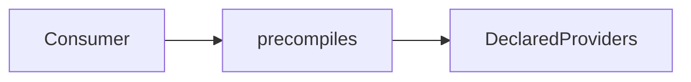

# `stwo_riscv_precompiles`

| Fact | Value |
| --- | --- |
| Version | `0.1.0` |
| Layer | `frontend` |
| Owner | `riscv-frontend` |
| Focused CI host | Linux |

## Purpose and architecture

Canonical precompiles source ownership under RFC #344; public module aliases point to one implementation each.

## Public API

`@import("stwo_riscv_precompiles")` exposes these consumed canonical source interfaces:

- `air_bulk_memcpy_caller_candidate`
- `air_bulk_memcpy_word_candidate`
- `air_caller_component_mask`
- `air_identity_hash`
- `air_keccakf_authority`
- `air_keccakf_lookup_tuples`
- `air_keccakf_multiplicities`
- `air_keccakf_relations`
- `air_keccakf_table_component`
- `air_keccakf_table_interaction`
- `air_keccakf_tables`
- `air_keccakf_throughput_tables`
- `air_keccakf_witness`
- `air_main_trace_test_support`
- `air_mask_layout`
- `air_mod`
- `air_relation_challenges`
- `air_relation_event`
- `air_relation_registry`
- `air_secp256k1_affine`
- `air_secp256k1_component`
- `air_secp256k1_component_interaction`
- `air_secp256k1_component_trace`
- `air_secp256k1_ecdsa`
- `air_secp256k1_ecdsa_direct`
- `air_secp256k1_field`
- `air_secp256k1_linear_direct`
- `air_secp256k1_mul_direct`
- `air_secp256k1_point_direct`
- `air_secp256k1_recovery`
- `air_secp256k1_recovery_direct`
- `air_secp256k1_relations`
- `air_secp256k1_scalar_direct`
- `air_secp256k1_split_direct`
- `air_secp256k1_table_direct`
- `air_sha256_compression`
- `air_sha256_compression_graph`
- `air_sha256_compression_rows`
- `air_sha256_memory_record`
- `air_sha256_packed_arithmetic`
- `air_sha256_packed_call`
- `air_sha256_packed_source`
- `air_sha256_relations`
- `air_sha256_word_program`
- `air_stack_swap_caller_candidate`
- `air_stack_swap_word_candidate`
- `air_tests_secp256k1_affine_test`
- `runner_bulk_memcpy_call_buffer`
- `runner_bulk_memcpy_session_tape`
- `runner_c011_elf_test_support`
- `runner_c011_scalar_reference_test_support`
- `runner_call_buffer`
- `runner_keccakf_call_buffer`
- `runner_secp256k1_recover_call_buffer`
- `runner_stack_swap_session_tape`
- `rv64_services_arith256`
- `rv64_services_secp256k1`
- `rv64_services_sha256`

## Dependencies

- `stwo_core`
- `stwo_prover_engine`
- `stwo_riscv_air_lang`
- `stwo_riscv_isa`
- `stwo_riscv_memory`

## Build, test, and run

`zig build test --build-file src/frontends/riscv/precompiles/build.zig -Doptimize=Debug -j2`

## Contract and invariants

Preserve field/proof bytes, canonical nominal types, errors, allocation, cancellation and teardown ownership. Existing behavior tests move with their owner; CPU proof byte identity and complete discovery remain required.

## Change checklist

Use the owned package contracts and existing developer entrypoints; do not relax pins, floors, proof checks or layer rejection.

## Related documentation

[Restructure plan](../../../../design/repository/restructure-plan.md) and [RFC #344](https://github.com/teddyjfpender/stwo-zig/issues/344).

The public aliases in this package are the concrete source interfaces already consumed by other owners. Each alias resolves to one owned implementation module, so shared records and callbacks retain one canonical nominal identity. Internal declarations in those modules retain their existing Zig visibility. New consumers should depend on the named package instead of a relative filesystem path; changes to these aliases or dependencies require the invariant owner's contract decision.

Request owners retain the original allocation and failure rules. Validate untrusted shapes before publication, complete fallible preparation before a commit boundary, and unwind every acquired resource on cancellation or error. A moved deinit method still owns exactly the same buffers. This split adds no runtime registry, environment policy, protocol revision or new proof format. The same behavior and rejection tests move with each implementation.

The compatibility umbrella continues to assemble the old module names for one minor version. Product-selecting orchestration stays above generic children. Complete Debug and ReleaseFast owner suites, preserved focused-test counts and frozen CPU proof bytes are the acceptance evidence. Syntax checks, a source-tree audit or a successful package build alone do not certify the complete proving pipeline or any GPU path.

## Typed domain interfaces

`air`, `primitives`, `recovery_abi`, `runner`, `testing`.

These names expose canonical domain owners. The `testing` namespace, when present, is an unstable qualification interface. Production request admission and product orchestration remain in the umbrella.
