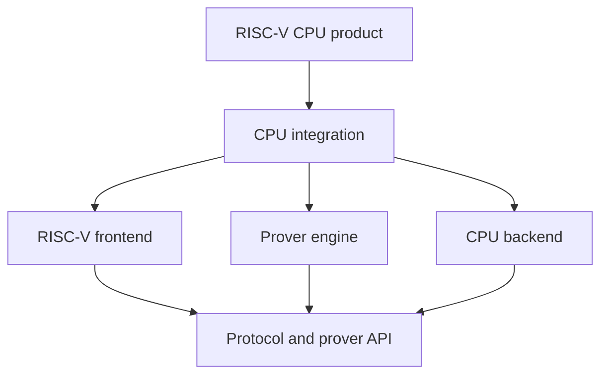

# `stwo_riscv_cpu_integration`

| Fact | Value |
| --- | --- |
| Version | `0.1.0` |
| Layer | `integration` |
| Owner | `riscv-cpu-integration` |
| Focused CI host | Linux |

## Purpose and architecture



This package binds the backend-neutral typed RV32IM frontend to the CPU prover engine. The RISC-V runner, witness, AIR, and statement rules remain owned by `src/frontends/riscv`; this package selects the CPU backend and supplies the proof adapter used by the released CPU product and CSP benchmarks.

The public module is [`mod.zig`](mod.zig). Its supported surface consists of `CpuProverEngine`, native proof and verification entry points, the Poseidon2 guest profile, the CSP-compatible Ethereum guest proof artifact, and the generic recursive FRI outer verifier. The Ethereum guest profile remains because CSP ECDSA uses it. It is distinct from the archived Ethereum **block** proving experiment.

## Build, test, and run

The CPU package also builds four detached SegmentV2 tools. They prove and verify bounded execution leaves and parent nodes; they do not claim whole-block memory/provider closure:

```sh
cd src/integrations/riscv_cpu
zig build build-recursive-segment-v2-detached-verifier \
  build-recursive-segment-v2-detached-parent-verifier \
  build-recursive-segment-v2-detached-leaf-producer \
  build-recursive-segment-v2-detached-parent-producer \
  -Doptimize=ReleaseSafe
```

Run `zig build test -Doptimize=ReleaseSafe` for package contracts and the retained detached-protocol tests. The genuine child-capture test additionally requires `STWO_SEGMENT_V2_CHILD_BUNDLE`, `STWO_SEGMENT_V2_CHILD_KEY_SHA256`, and `STWO_SEGMENT_V2_CHILD_EXPECTED_WIRE` pointing to the admitted fixture. Focused proof/verify checks are `test-secp256k1-precompile-proof` (set `STWO_CSP_FIXTURE_ROOT` to the absolute `vectors/riscv_csp` directory), `test-segment-v2-native-proof`, and `test-universal-typed-proof`. Use [`scripts/riscv/riscv_recursive_product.py`](../../../scripts/riscv/riscv_recursive_product.py) for the end-to-end 1/2/4/8-segment development gate. The released CPU product and CSP benchmark route build from the repository root with `zig build stwo-zig-riscv-cpu` and `zig build riscv-csp-bench`.

The former Ethereum block-v5 architecture, provider experiments, and their build commands are preserved at `archive/riscv-ethereum-block-v5-20261006` (commit `f374b1db6`), rather than part of the supported package. A future block pipeline must define and verify its complete block statement, including memory and provider closure, before it is exposed here.


## Protocol profiles and historical measurements

The experimental concrete [`rv64`](rv64.zig) API proves bounded RV64IM execution
with verifier-owned program/state, local register consistency and authenticated
RAM transitions in one STARK. `prove` builds the witness once; `provePrepared`
accepts untrusted prepared rows. `verifyOwned` consumes a proof on every path.
For repeated verification, retain `PreparedSetup`, independently derived from
expected program/path/final-PC bytes; request state and transcript stay fresh.
Run `zig build test-riscv64-air test-riscv64-proof -Doptimize=ReleaseSafe` from
the repository root. This separate bounded profile is not the released ELF/CSP
or OP guest proof route. See [the AIR contract](../../../design/riscv/rv64-air.md).

The experimental [`rv64_full`](rv64_full.zig) API admits one complete execution
in one shared PCS/composition/FRI proof. Its immutable program ROM and byte/AND/
shift tables have independent heights. `PreparedSetup` separates program-derived
ROM from geometry-specific fixed roots; callers retain it across verification
requests. Statements bind the complete initial/final state, permissions, clocks
and admitted opcode set. The AIR forbids opcodes outside that set and closes
all state and lookup claims. `proveTrace` consumes physical column storage after
commitment, allowing the capture journal to be freed first. The CSP tools verify
separately against an independently checked ELF/input/output contract; a producer's
statement file alone is not application authority. This remains an experimental
profile, separate from the bounded `rv64` format and the Rust five-opcode fixture.

Build `rv64-csp-full` and `rv64-full-verify` with
`zig build rv64-csp-full rv64-full-verify -Doptimize=ReleaseFast`. Run the complete benchmark with
`scripts/rv64/riscv64_csp_full_proofs.py`, supplying `--execution-report`, `--work-dir`
and `--report`; `--prover` and `--verifier` allow immutable measured binaries.
`--profile-only` explicitly does not establish a proof. The driver independently
checks expected ELF/input/output authority and runs the receiver in a new process.
The [17-case comparison CSV](https://github.com/teddyjfpender/stwo-zig/tree/archive/pre-restructure-20261108/vectors/reports/rv64-qualification-20261030/csp-full-comparison.csv)
records serial/parallel measurements; all 17 statement, claim and proof byte
streams match exactly. Focused tests are `test-riscv64-air`,
`test-riscv64-program`, `test-riscv64-program-proof`, `test-riscv64-providers`,
`test-riscv64-coset`, `test-riscv64-parallel`, `test-riscv64-full-capture` and
`test-riscv64-full-proof`.


Whole-prover profiling is enabled with `--profile-stages` in the CSP driver.
It uses the shared stage recorder without task/work capture and preserves the
exact transcript and proof. The [performance comparison](https://github.com/teddyjfpender/stwo-zig/tree/archive/pre-restructure-20261108/vectors/reports/rv64-performance-20261030/comparison.csv)
records all 17 cases, checked against equal input, geometry, security, worker
count and serialized proof bytes. Full ECDSA now takes approximately 21 seconds
end to end on the measured host. See the [study](https://github.com/teddyjfpender/stwo-zig/tree/archive/pre-restructure-20261108/vectors/reports/rv64-performance-20261030/README.md)
for attribution, repeat ranges and the remaining constraint-row cost.

The [second performance round](https://github.com/teddyjfpender/stwo-zig/tree/archive/pre-restructure-20261108/vectors/reports/rv64-performance-round2-20261030/README.md)
retains universal memory-polynomial factoring and an owned main-witness handoff
to PCS. All 17 statements, claims and proofs remain byte-identical. ECDSA takes
about 19.6 seconds in the matched suite; composition still sets the 12.78 GiB
caller peak. Rejected scheduling/zero-shortcut experiments are documented.

## Public API

Consumers import the declared module rather than relative source files:

```zig
const riscv = @import("stwo_riscv_cpu_integration");
```

The names below reproduce the existing `api_surface` ledger in
[`package.contract.json`](package.contract.json); this documentation does not
change that ledger or certify every exported experimental path. Workspace
validation still reports undeclared circuit dependencies and additional source
exports. The Ethereum experiment and archived-block distinction described above
must be reconciled through the contract-change process before the product
boundary can be considered closed.

### Proving, verification and support

`CpuProverEngine`, `Poseidon2InteractionClaim`, `Poseidon2ProveOutput`, `bulk_memcpy_current_selected_segment_authority_v1`,
`bulk_memcpy_retained_journal_v1`, `bulk_memcpy_retained_microproof_command_v1`, `bulk_memcpy_retained_microproof_receipt_v1`, `bulk_memcpy_retained_microproof_receipt_v2`,
`bulk_memcpy_retained_microproof_v1`, `bulk_memcpy_retained_observation_v1`, `bulk_memcpy_retained_replay_v1`, `bulk_memcpy_statement_artifact_v1`,
`bulk_memcpy_tape_artifact_v1`, `diagnoseRiscVRelations`, `poseidon2_proof_artifact`, `proveAndVerifyElf`,
`proveEthereumBlock`, `provePoseidon2WithPublicData`, `proveRiscV`, `proveRiscVSegmentV2`,
`proveRiscVWithPublicData`, `proveRiscVWithPublicDataAndExecution`, `proveRiscVWithRecorder`, `resource_usage`,
`verifyPoseidon2`, `verifyRiscV`, `verifyRiscVSegmentV2`.

### Ethereum artifacts and experiments

`ethereum_block_compact_replay`, `ethereum_block_compact_replay_receipt`, `ethereum_block_leaf_compact_manifest`, `ethereum_block_leaf_contract`,
`ethereum_block_leaf_evidence`, `ethereum_block_leaf_materializer`, `ethereum_block_leaf_producer`, `ethereum_block_leaf_support`,
`ethereum_block_leaf_verifier`, `ethereum_candidate_combined_execution_capture_command_v1`, `ethereum_candidate_combined_execution_capture_receipt_v1`, `ethereum_candidate_combined_execution_capture_v1`,
`ethereum_candidate_combined_execution_replay_command_v1`, `ethereum_candidate_combined_execution_replay_receipt_v1`, `ethereum_candidate_combined_execution_replay_v1`, `ethereum_candidate_degree5_provider_batch_execution_v1`,
`ethereum_candidate_degree5_provider_order_batch_v1`, `ethereum_candidate_degree5_provider_prepared_batch_v1`, `ethereum_degree5_provider_proof_artifact_v1`, `ethereum_guest_pc_profile`,
`ethereum_incremental_capture_materializer_v3`, `ethereum_incremental_capture_materializer_v4`, `ethereum_incremental_capture_postprocess_command_v4`, `ethereum_incremental_full_leaf_replay_command_v4`,
`ethereum_incremental_full_leaf_throughput_execution_v1`, `ethereum_incremental_native_leaf_profile_v3`, `ethereum_incremental_native_leaf_proof_artifact_v3`, `ethereum_incremental_native_leaf_proof_v3`,
`ethereum_matched_ab_geometry_audit_v1`, `ethereum_matched_ab_leaf_request_v1`, `ethereum_matched_ab_rematerialization_authority_v1`, `ethereum_matched_ab_rematerialization_command_v1`,
`ethereum_matched_ab_rematerialization_controller_v1`, `ethereum_poseidon_leaf_geometry_command`, `ethereum_poseidon_leaf_geometry_snapshot`, `ethereum_poseidon_leaf_matched_ab_baseline_command_v1`,
`ethereum_poseidon_leaf_matched_ab_result_v1`, `ethereum_poseidon_leaf_product_contract`, `ethereum_poseidon_leaf_product_producer`, `ethereum_poseidon_leaf_product_request`,
`ethereum_poseidon_leaf_product_verifier`, `ethereum_poseidon_leaf_profile_receipt`, `ethereum_poseidon_provider_call_artifact_v1`, `ethereum_poseidon_provider_combined_v1`,
`ethereum_poseidon_provider_fused_v1`, `ethereum_poseidon_provider_hpc_benchmark_v1`, `ethereum_poseidon_provider_prepared_capture_receipt_v1`, `ethereum_poseidon_provider_prepared_capture_v1`,
`ethereum_poseidon_provider_proof_artifact_v1`, `ethereum_poseidon_provider_proof_artifact_v2`, `ethereum_poseidon_provider_raw_batch_benchmark_v2`, `ethereum_poseidon_provider_raw_pair_benchmark_v1`,
`ethereum_poseidon_provider_resource_plan_v1`, `ethereum_poseidon_provider_retained_batch_receipt_v3`, `ethereum_poseidon_provider_retained_batch_v3`, `ethereum_poseidon_provider_retention_admission_v2`,
`ethereum_poseidon_provider_retention_sweep_v1`, `ethereum_poseidon_provider_stage_a_checkpoint_v1`, `ethereum_poseidon_provider_stage_b_lifecycle_v1`, `ethereum_poseidon_provider_stage_b_prefix_v2`,
`ethereum_poseidon_provider_topology_sweep_v1`, `ethereum_precompile_artifact_io`, `ethereum_proof_artifact`, `ethereum_provider_omitted_leaf_bundle_v1`,
`ethereum_segment_proof_artifact`, `ethereum_segment_source_wire`, `ethereum_unoptimized_baseline_admission_receipt_v1`, `ethereum_unoptimized_baseline_admission_v1`.

### Recursive protocols and artifacts

`recursive_circuit_registry_v1`, `recursive_common_ethereum_incremental_leaf_field_public_v4`, `recursive_common_ethereum_incremental_leaf_input_v4`, `recursive_common_fold_field_public_v2`,
`recursive_common_fold_input_v1`, `recursive_common_fold_input_v2`, `recursive_common_real_omitted_leaf_input_v1`, `recursive_common_wrapper_authority_v1`,
`recursive_common_wrapper_authority_v2`, `recursive_common_wrapper_manifest_v1`, `recursive_common_wrapper_padding_v1`, `recursive_field_node_public_v2`,
`recursive_fri_outer`, `recursive_node_artifact_store_v1`, `recursive_node_artifact_store_v2`, `recursive_node_artifact_v2`,
`recursive_pipeline_worker_protocol_v1`, `recursive_pipeline_worker_v1`.

### RV64 profiles

`rv64`, `rv64_full`.

## Dependencies

The declared package dependencies are:

| Package | Boundary used |
| --- | --- |
| `stwo_artifact_store` | Artifact retention and retrieval |
| `stwo_core` | Fields, transcript, proof and verifier types |
| `stwo_cpu_backend` | CPU proving backend |
| `stwo_prover_api` | Backend and prover capability contracts |
| `stwo_prover_engine` | Proving and polynomial machinery |
| `stwo_riscv_frontend` | ISA, witness, AIR and statement rules |

Circuit imports currently detected outside this ledger remain workspace errors;
they are not authorized by this table. Named build-injected modules are listed
separately in the package contract and remain owned by the composing build.

## Contract and invariants

The runner and AIR belong to the frontend. This integration chooses concrete
CPU implementations, while the consuming product owns application inputs and
expected statement authority. A prover-supplied statement does not replace the
receiver's independent expected program, state and output checks. Prepared setup
is retained only across requests with the matching immutable setup identity;
request transcript state is fresh. Allocation failures and rejected requests
must preserve the publication and teardown rules of their actual owner.

The retained contract suites cover division closure, services truth, recursion
DAG scheduling and publication, alongside the package's larger protocol tests.
Focused local checks use `scripts/dev_test.py`. The exact declared Linux CI
command, run from the repository root, is:

```sh
zig build test --build-file src/integrations/riscv_cpu/build.zig -Doptimize=ReleaseFast -j2
```

A bounded host test or semantic compile is evidence for that check alone. Full
product acceptance, semantic negative cases and qualification remain separate
obligations; no complete-block or performance result follows from this guide.

## Change checklist

- Preserve the frontend's statement, transcript and verifier authority.
- Run the changed owner's focused tests through `scripts/dev_test.py` and record
  the build mode and exact source used.
- Review cancellation, allocation failure, cleanup and publication ownership
  whenever moving an implementation.
- Follow the approved RFC process before changing public exports, dependencies,
  error semantics or protocol compatibility; documentation does not approve one.
- Report code, flags and scripts separately from documentation and receipts.

## Related documentation

- [Engineering standards](../../../ENGINEERING_STANDARDS.md)
- [Restructure plan](../../../design/repository/restructure-plan.md)
- [RISC-V frontend owner guide](../../frontends/riscv/README.md)
- [RV64 delivery contract](../../../design/riscv/rv64-gpu-hygiene.md)
