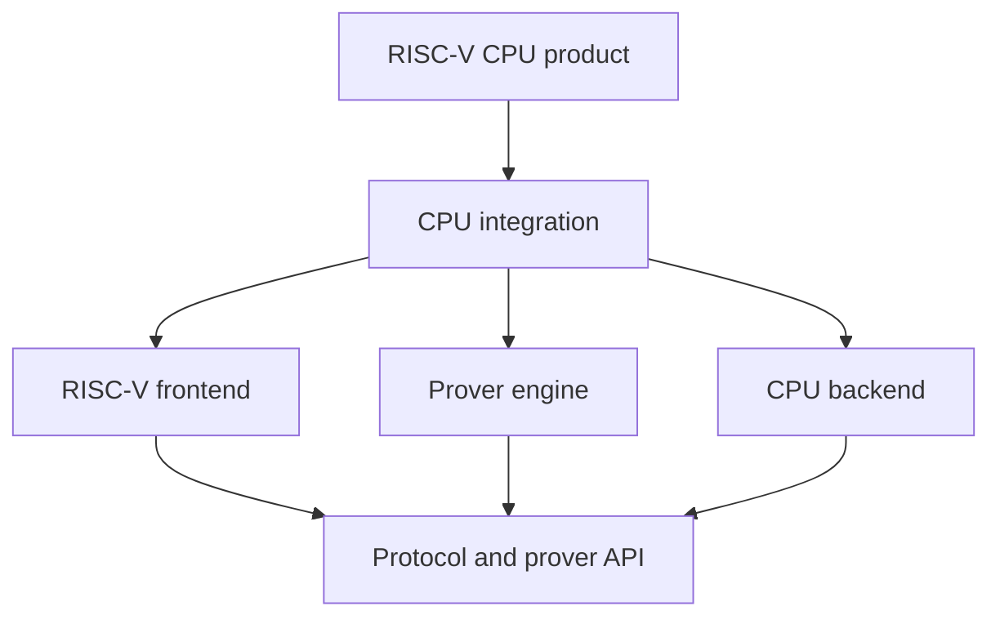

# `stwo_riscv_cpu_integration`

| Fact | Value |
| --- | --- |
| Version | `1.0.0` |
| Layer | `integration` |
| Owner | `riscv-cpu-integration` |
| Focused CI host | Linux |

## Purpose and architecture



This package binds the backend-neutral typed RV32IM frontend to the CPU prover engine. The RISC-V runner, witness, AIR, and statement rules remain owned by `src/frontends/riscv`; this package selects the CPU backend and supplies the proof adapter used by the released CPU product and CSP benchmarks.

The public module is [`mod.zig`](mod.zig). It selects `CpuProverEngine` and exposes native proving/verification, service proof adapters, shared artifact helpers and recursion. Ethereum adapters remain compatibility surface pending the approved [product extraction](https://github.com/teddyjfpender/stwo-zig/issues/352); their presence does not make that extraction complete.

The existing build also consumes `stwo_circuit_recursion_wire`. Their providers stay explicit in the package manifest; injected aliases do not replace these concrete dependency edges.

## Build, test, and run

The CPU package also builds four detached SegmentV2 tools. They prove and verify bounded execution leaves and parent nodes; they do not claim whole-block memory/provider closure:

```sh
cd src/integrations/riscv_cpu
zig build build-recursive-segment-v2-detached-verifier \
  build-recursive-segment-v2-detached-parent-verifier \
  build-recursive-segment-v2-detached-leaf-producer \
  build-recursive-segment-v2-detached-parent-producer \
  -Doptimize=ReleaseSafe
```

Run `zig build test -Doptimize=ReleaseSafe` for package contracts and the retained detached-protocol tests. The genuine child-capture test additionally requires `STWO_SEGMENT_V2_CHILD_BUNDLE`, `STWO_SEGMENT_V2_CHILD_KEY_SHA256`, and `STWO_SEGMENT_V2_CHILD_EXPECTED_WIRE` pointing to the admitted fixture. The same required case can be run first with `zig build test-detached-child-capture --build-file src/integrations/riscv_cpu/build.zig -Doptimize=ReleaseFast -j2`; its minimum-one discovery guard and the full package case remain mandatory. Focused proof/verify checks are `test-secp256k1-precompile-proof` (set `STWO_CSP_FIXTURE_ROOT` to the absolute `vectors/riscv_csp` directory), `test-segment-v2-native-proof`, and `test-universal-typed-proof`. Use [`scripts/riscv/riscv_recursive_product.py`](../../../scripts/riscv/riscv_recursive_product.py) for the end-to-end 1/2/4/8-segment development gate. The released CPU product and CSP benchmark route build from the repository root with `zig build stwo-zig-riscv-cpu` and `zig build riscv-csp-bench`.

The former Ethereum block-v5 architecture, provider experiments, and their build commands are preserved at `archive/riscv-ethereum-block-v5-20261006` (commit `f374b1db6`), rather than part of the supported package. A future block pipeline must define and verify its complete block statement, including memory and provider closure, before it is exposed here.


## Protocol profiles and historical measurements

The experimental concrete [`rv64`](rv64.zig) API proves bounded RV64IM execution
with verifier-owned program/state, local register consistency and authenticated
RAM transitions in one STARK. `prove` builds the witness once; `provePrepared`
accepts untrusted prepared rows. `verifyOwned` consumes a proof on every path.
For repeated verification, retain `PreparedSetup`, independently derived from
expected program/path/final-PC bytes; request state and transcript stay fresh.
Run `zig build test-riscv64-air test-riscv64-proof -Doptimize=ReleaseSafe` from
the repository root. This separate bounded profile is not the released ELF/CSP
or OP guest proof route. See [the AIR contract](../../../design/riscv/rv64-air.md).

The experimental [`rv64_full`](rv64_full.zig) API admits one complete execution
in one shared PCS/composition/FRI proof. Its immutable program ROM and byte/AND/
shift tables have independent heights. `PreparedSetup` separates program-derived
ROM from geometry-specific fixed roots; callers retain it across verification
requests. Statements bind the complete initial/final state, permissions, clocks
and admitted opcode set. The AIR forbids opcodes outside that set and closes
all state and lookup claims. `proveTrace` consumes physical column storage after
commitment, allowing the capture journal to be freed first. The CSP tools verify
separately against an independently checked ELF/input/output contract; a producer's
statement file alone is not application authority. This remains an experimental
profile, separate from the bounded `rv64` format and the Rust five-opcode fixture.

Build `rv64-csp-full` and `rv64-full-verify` with
`zig build rv64-csp-full rv64-full-verify -Doptimize=ReleaseFast`. Run the complete benchmark with
`scripts/rv64/riscv64_csp_full_proofs.py`, supplying `--execution-report`, `--work-dir`
and `--report`; `--prover` and `--verifier` allow immutable measured binaries.
`--profile-only` explicitly does not establish a proof. The driver independently
checks expected ELF/input/output authority and runs the receiver in a new process.
The [17-case comparison CSV](https://github.com/teddyjfpender/stwo-zig/tree/archive/pre-restructure-20261108/vectors/reports/rv64-qualification-20261030/csp-full-comparison.csv)
records serial/parallel measurements; all 17 statement, claim and proof byte
streams match exactly. Focused tests are `test-riscv64-air`,
`test-riscv64-program`, `test-riscv64-program-proof`, `test-riscv64-providers`,
`test-riscv64-coset`, `test-riscv64-parallel`, `test-riscv64-full-capture` and
`test-riscv64-full-proof`.


Whole-prover profiling is enabled with `--profile-stages` in the CSP driver.
It uses the shared stage recorder without task/work capture and preserves the
exact transcript and proof. The [performance comparison](https://github.com/teddyjfpender/stwo-zig/tree/archive/pre-restructure-20261108/vectors/reports/rv64-performance-20261030/comparison.csv)
records all 17 cases, checked against equal input, geometry, security, worker
count and serialized proof bytes. Full ECDSA now takes approximately 21 seconds
end to end on the measured host. See the [study](https://github.com/teddyjfpender/stwo-zig/tree/archive/pre-restructure-20261108/vectors/reports/rv64-performance-20261030/README.md)
for attribution, repeat ranges and the remaining constraint-row cost.

The [second performance round](https://github.com/teddyjfpender/stwo-zig/tree/archive/pre-restructure-20261108/vectors/reports/rv64-performance-round2-20261030/README.md)
retains universal memory-polynomial factoring and an owned main-witness handoff
to PCS. All 17 statements, claims and proofs remain byte-identical. ECDSA takes
about 19.6 seconds in the matched suite; composition still sets the 12.78 GiB
caller peak. Rejected scheduling/zero-shortcut experiments are documented.

## Native execution domain

`rv64_execution` binds the existing native witness/setup/proof, service, memory,
delegation and source owners. It retains their exact types, bytes and lifetime
rules; it does not establish Ethereum request/image authority. The old expected
image name belongs to product compatibility.

## Public API

Consumers import the declared module rather than relative source files:

```zig
const riscv = @import("stwo_riscv_cpu_integration");
```

The following ledger is regenerated from the existing top-level public exports
of `mod.zig`. This corrects stale declarations without adding implementation
symbols or changing proof bytes. An exported experimental path is not a claim
of release qualification: independent proof acceptance and each product's
published admission gates remain authoritative. Product-specific source moves
are tracked separately from this metadata reconciliation.

- `Blake3Execution`
- `CpuProverEngine`
- `Poseidon2InteractionClaim`
- `Poseidon2ProveOutput`
- `diagnoseRiscVRelations`
- `poseidon2_proof_artifact`
- `proveAndVerifyElf`
- `provePoseidon2WithPublicData`
- `proveRiscV`
- `proveRiscVSegmentV2`
- `proveRiscVWithPublicData`
- `proveRiscVWithPublicDataAndExecution`
- `proveRiscVWithRecorder`
- `recursive_fri_outer`
- `resource_usage`
- `rv64`
- `rv64_cpu_source`
- `rv64_device_core_headers`
- `rv64_device_main`
- `rv64_device_pcs`
- `rv64_device_source_stage`
- `rv64_family_input`
- `rv64_full`
- `rv64_gkr_bundle_wire`
- `rv64_gkr_chain`
- `rv64_gkr_child`
- `rv64_gkr_constraints`
- `rv64_gkr_coordinator`
- `rv64_gkr_cpu_components`
- `rv64_gkr_cpu_replay`
- `rv64_gkr_cpu_worker`
- `rv64_gkr_execution`
- `rv64_gkr_fixed_authority`
- `rv64_gkr_fixed_authority_set`
- `rv64_gkr_global_cpu`
- `rv64_gkr_local_roster`
- `rv64_gkr_manifest`
- `rv64_gkr_manifest_wire`
- `rv64_gkr_native_provider`
- `rv64_gkr_receipt`
- `rv64_gkr_source`
- `rv64_gkr_source_bounds`
- `rv64_gkr_truth_device_composition`
- `rv64_gkr_truth_device_source`
- `rv64_gkr_truth_products`
- `rv64_gkr_truth_role`
- `rv64_gkr_truth_v3_catalog`
- `rv64_gkr_truth_v3_role`
- `rv64_gkr_wire`
- `rv64_gkr_worker_protocol`
- `rv64_large_block_recycler`
- `rv64_memory_input`
- `rv64_native_gkr_cpu`
- `rv64_native_gkr_roster`
- `rv64_native_gkr_section`
- `rv64_native_gkr_v2`
- `rv64_native_policy`
- `rv64_native_rungs`
- `rv64_execution`
- `rv64_native_schema`
- `rv64_om31_cpu_leaf`
- `rv64_om31_execution_wrap`
- `rv64_om31_outer`
- `rv64_om31_outer_wrap`
- `rv64_om31_ready_dag`
- `rv64_om31_security_candidate`
- `rv64_om31_services_root`
- `rv64_om31_typed_fold`
- `rv64_om31_typed_summary`
- `rv64_outer_gkr_binding`
- `rv64_outer_gkr_profile`
- `rv64_outer_gkr_section`
- `rv64_outer_hybrid_air`
- `rv64_outer_hybrid_child`
- `rv64_outer_hybrid_device`
- `rv64_outer_hybrid_receiver`
- `rv64_outer_hybrid_wire`
- `rv64_outer_mle_point`
- `rv64_pcs_suite`
- `rv64_program`
- `rv64_program_metadata`
- `rv64_proof_artifact_support`
- `rv64_provider_tails`
- `rv64_recursion_budget`
- `rv64_replay_capture`
- `rv64_root_verify`
- `rv64_services_collector`
- `rv64_services_roster`
- `rv64_services_types`
- `rv64_vk_table`
- `verifyPoseidon2`
- `verifyRiscV`
- `verifyRiscVSegmentV2`

## Dependencies

- `stwo_circuit_frontend`: shared circuit program and preprocessing authorities.
- `stwo_circuit_cpu_integration`: existing OM31 fold/root proof and wire provider.

The declared package dependencies are:

| Package | Boundary used |
| --- | --- |
| `stwo_artifact_store` | Artifact retention and retrieval |
| `stwo_core` | Fields, transcript, proof and verifier types |
| `stwo_cpu_backend` | CPU proving backend |
| `stwo_prover_api` | Backend and prover capability contracts |
| `stwo_prover_engine` | Proving and polynomial machinery |
| `stwo_riscv_frontend` | ISA, witness, AIR and statement rules |

Circuit imports currently detected outside this ledger remain workspace errors;
they are not authorized by this table. Named build-injected modules are listed
separately in the package contract and remain owned by the composing build.

## Contract and invariants

The runner and AIR belong to the frontend. This integration chooses concrete
CPU implementations, while the consuming product owns application inputs and
expected statement authority. A prover-supplied statement does not replace the
receiver's independent expected program, state and output checks. Prepared setup
is retained only across requests with the matching immutable setup identity;
request transcript state is fresh. Allocation failures and rejected requests
must preserve the publication and teardown rules of their actual owner.

The retained contract suites cover division closure, services truth, recursion
DAG scheduling and publication, alongside the package's larger protocol tests.
Focused local checks use `scripts/dev_test.py`. The exact declared Linux CI
command, run from the repository root, is:

```sh
zig build test --build-file src/integrations/riscv_cpu/build.zig -Doptimize=ReleaseFast -j2 --verbose --summary all
```

A bounded host test or semantic compile is evidence for that check alone. Full
product acceptance, semantic negative cases and qualification remain separate
obligations; no complete-block or performance result follows from this guide.

## Change checklist

- Preserve the frontend's statement, transcript and verifier authority.
- Run the changed owner's focused tests through `scripts/dev_test.py` and record
  the build mode and exact source used.
- Review cancellation, allocation failure, cleanup and publication ownership
  whenever moving an implementation.
- Follow the approved RFC process before changing public exports, dependencies,
  error semantics or protocol compatibility; documentation does not approve one.
- Report code, flags and scripts separately from documentation and receipts.

## Related documentation

- [Engineering standards](../../../ENGINEERING_STANDARDS.md)
- [Restructure plan](../../../design/repository/restructure-plan.md)
- [RISC-V frontend owner guide](../../frontends/riscv/README.md)
- [RV64 delivery contract](../../../design/riscv/rv64-gpu-hygiene.md)

RFC [#324](https://github.com/teddyjfpender/stwo-zig/issues/324) declares the
existing OM31 CPU collaboration boundary. The circuit provider owns program,
proof, wire and allocation teardown; the RISC-V consumer owns receiver policy,
tree coverage and publication. Canonical package modules share field and engine
identity. OM31 retains its existing **prefixed** Blake2s Merkle hasher and raw-mod
transcript; the older circuit profiles retain their existing plain family.
No hash family, wire bytes, profile admission or device qualification changes.

`rv64_proof_artifact_support` exposes the single shared physical-cell accounting
and durable-file implementation. Ethereum receipt schema and chain checkpoint
policy remain with the product adapter. Run its owner and real public-consumer
contracts with `zig build test-proof-artifact-support --build-file
src/integrations/riscv_cpu/build.zig -Doptimize=Debug -j1` (also ReleaseFast).
The default package test includes the consumer; no self-module reconstruction
or duplicate record definition is used.

For bounded local work, `python3 scripts/dev_test.py --optimize Debug
src/integrations/riscv_cpu/rv64_proof_artifact_support.zig` executes the actual
public consumer and three private owner cases directly, under the same build
lock. Use ReleaseFast for its other required mode. The full package build and
proof acceptance remain separate checks.


### Coordinator early-source boundary

`rv64_gkr_coordinator.ForEarlySources(Cpu0, Segments)` specializes only producer
operations. The neutral default uses `void, void`, making the two early-source
fields null-typed; it cannot name or select a product owner. Ethereum compatibility
binds its existing concrete owners in the product. Bundle, stream, worker timing,
encoded workers and request records retain one canonical native owner.

The returned domain also exposes the existing operational `planAdmission` and
`produceWithPolicy` bodies plus the owned `Admission.deinit`. They do not accept
proofs or supply verification authority. Frozen tree policy still passes the
original `tree_selection.validate`; inventory reconstruction, manifest closure,
cancellation and teardown checks remain mandatory. All returned domain methods
retain existing error and lifetime semantics. This unpublished 1.0.0 candidate
requires the product consumer and complete execution gates before qualification.
