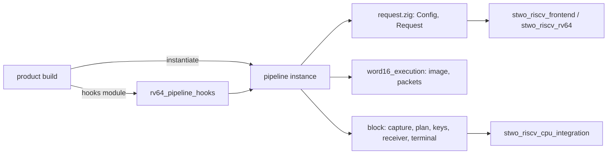

# Shared RV64 block proving pipeline

Public module `stwo_riscv_rv64_pipeline`.

| Fact | Value |
|---|---|
| Version | `0.1.0` |
| Layer | `integration` |
| Owner | `riscv-cpu-integration` |
| Focused CI host | Linux |
| Status | RFC-1 pending owner decision; exception E-1 (duplicates the native subset of the first RV64 product's private block pipeline) |

## Purpose

This package is the product-neutral RV64 block pipeline: capture one guest
execution, plan its CPU and service proofs, prove them natively on the CPU and
receive the bundle with a fresh receiver that derives its own source keys and
FIXED roots. A second RV64 product line needs this pipeline, and a product
may not import another product, so the native subset of the first RV64
product's private word16 block pipeline is copied here with every product
name removed. That product keeps its private copy until a separate,
owner-approved migration proves byte identity (RFC-1, exception E-1, issue
#390).

Products plug in through a comptime hooks contract. The hooks decide which
guest, input and output a proof binds. They never choose transcript order, AIR
shape or proof bytes.

## Architecture



The build exposes a template module and a BUILD-only `instantiate(b, template,
hooks)` function. Each product creates its own instance bound to its own hooks
module, so two products never share a hooks binding. Shared owners
(`stwo_riscv_cpu_integration`, `stwo_riscv_frontend`, `stwo_riscv_rv64`,
`stwo_riscv_precompiles`, `stwo_prover_engine`, `stwo_circuit_cpu_integration`)
are read from the selected CPU integration, one concrete instance each.

## Public API

```zig
const pipeline = @import("stwo_riscv_rv64_pipeline");
const Op = pipeline.Pipeline(@import("rv64_pipeline_hooks"));
```

- `Pipeline` returns the pipeline bound to one hooks module: `request`, `image`,
  `plan`, `keys`, `receiver`, `terminal`, `resources` and the native CLI `main`
  (`describe-candidate`, `plan`, `produce-candidate`, `verify-candidate`,
  `verify-prefix-candidate`), plus `runArgv` for a product that translates its
  own command surface onto that argv.
- `ProductHooks` documents the contract: required declarations, guest ABI
  fields and the `violation` checker.
- `ServiceFamily` is the RFC-3 extension shape. Products declare none in S1.
- `assertHooks` rejects an incomplete hooks module at compile time.

## Dependencies

- `stwo_riscv_cpu_integration`: Word16 execution, services, GKR workers and keys.
- `stwo_riscv_frontend`: the shared `rv64_air` namespace.
- `stwo_riscv_rv64`: execution profiles, tapes, ELF loading and the call ABI.
- `stwo_riscv_precompiles`: secp256k1, SHA-256 and arith256 primitives for the
  services session.
- `stwo_prover_engine`: allocators, PCS columns and stage profiles.
- `stwo_circuit_cpu_integration`: referenced only by the recursion-enabled path,
  which this package never selects; it is already in the CPU integration's
  closure.

The package declares no direct waist dependency, so it needs no CDC consumer
registration in `stwo_core` or `stwo_prover_api`.

## Build, test, and run

```sh
zig build test --build-file src/integrations/riscv_cpu/rv64_pipeline/build.zig -Doptimize=Debug -j2 --verbose --summary all
```

The `test` step instantiates the pipeline with `tests/example_hooks.zig`, a
reference guest layout with a 4..16 MiB input window, and runs the hook
contract, terminal, receiver, resource and plan suites. The setup-cache
artifact suite stays with the original private copy, because its OM31 channel fixture
needs a direct `stwo_core` dependency this package does not declare.

## Contract and invariants

- No product name appears in this package's paths, identifiers, strings or
  API. The two producer diagnostic digest domains (`block/capture.zig`,
  `block/capture_digest.zig`) are renamed to `stwo/rv64/pipeline/...`; neither
  digest enters a proof, transcript or bundle (the advice digest has no caller
  and the captured-values digest is compiled off), so proof bytes are unchanged.
- The hooks `label` never reaches a transcript, domain separator or digest.
- A profile the hooks do not admit is rejected before any ELF, input or
  capture work (`tests/hooks_test.zig`).
- An empty `service_families` keeps the base roster, so proof bytes equal the
  base pipeline's.
- The package reads no environment. Producer setup acceleration is selected by
  leading CLI arguments (`--setup-cache DIR`, `--setup-identity-only 0|1`,
  `--setup-build-threads N`), and receivers refuse `--setup-cache`. The M8
  split-family truth experiment is fixed off here.

## Change checklist

- Keep the package product-neutral; product behaviour belongs in the product's
  hooks or above the pipeline.
- Changes to proof bytes need an RFC and a golden test first.
- Update the contract budget and the `rv64-productionisation-budget` entry with
  every growth.

## Related documentation

- [Restructure plan](../../../../design/repository/restructure-plan.md)
- [Engineering standards](../../../../ENGINEERING_STANDARDS.md)
