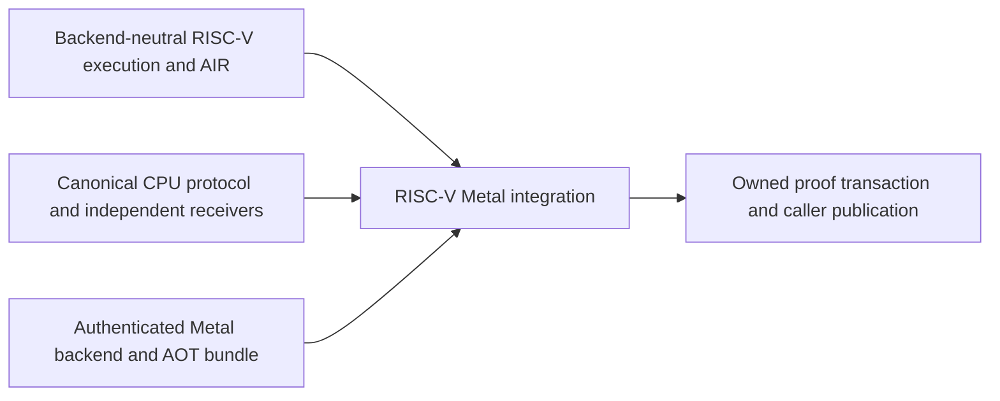

# `stwo_riscv_metal_integration`

| Property | Value |
| :--- | :--- |
| Version | `0.2.0` |
| Layer | `integration` |
| Owner | `riscv-metal-integration` |
| Public Zig module | `stwo_riscv_metal_integration` |
| Focused CI host | macOS |

## Purpose and architecture

This package binds the typed RV32IM frontend to the fail-closed Metal prover engine. The frontend owns execution and AIR semantics; the integration selects authenticated Metal proving and never substitutes the CPU backend after a runtime failure.

[`mod.zig`](mod.zig) exposes `MetalProverEngine`, RISC-V prove/verify entry points, stage recording, and the guest precompile adapter. The released Metal product and CSP benchmark route build from the repository root with `zig build stwo-riscv-metal` and `zig build riscv-csp-bench-metal` on a Metal-capable Mac with an authenticated AOT bundle.

The package's focused build graph retains device-free contract tests, canonical CSP ECDSA proof/verify gates, and the shared detached SegmentV2 leaf and parent producers:

```sh
cd src/integrations/riscv_metal
zig build test -Doptimize=ReleaseSafe
STWO_CSP_FIXTURE_ROOT="/absolute/path/to/authenticated/csp-fixtures" \
  zig build test-blake3-csp-ecdsa-jit -Doptimize=ReleaseFast
zig build build-recursive-segment-v2-detached-leaf-producer \
  build-recursive-segment-v2-detached-parent-producer \
  -Doptimize=ReleaseSafe
```

The authenticated CSP gate is `test-blake3-csp-ecdsa-aot -Dmetal-core-aot-bundle=<absolute-path>`. The CPU package supplies the independent detached leaf and parent verifiers. The Metal producers use the same typed SegmentV2 protocol and require an authenticated AOT runtime for a real proof. The old Stage101 and Ethereum block-v5 command graph is preserved on `archive/riscv-ethereum-block-v5-20261006` (commit `f374b1db6`) and is not a supported Metal product surface.

The package boundary is defined by [`build.zig`](build.zig), [`mod.zig`](mod.zig), and [`package.contract.json`](package.contract.json).



## Public API

```zig
const riscv_metal = @import("stwo_riscv_metal_integration");
const Engine = riscv_metal.MetalProverEngine;
```

The primary module exports `MetalProverEngine`, `guest_precompile`,
`proveAndVerifyElf`, `proveRiscV`, `proveRiscVWithPublicData`,
`proveRiscVWithRecorder`, `riscv_polynomial_codegen`, and `verifyRiscV`.
These are the existing integration entry points, not a new fallback or a
change to proof encoding. The caller supplies statement inputs and allocation;
prepared runtime identity and transaction lifetime remain explicit. Admission
failure must not publish an artifact or select the CPU prover implicitly.

## Dependencies

- `stwo_core` owns field and transcript values.
- `stwo_metal_backend` owns the device/runtime implementation.
- `stwo_prover_api` owns the shared transaction contract.
- `stwo_prover_engine` owns generic proving machinery.
- `stwo_riscv_frontend` owns ISA, execution and AIR semantics.
- `stwo_riscv_cpu_integration` owns the canonical shared protocol and independent receivers.

The test-only `blake3_runtime` alias is built from this package's own source;
it is not an opaque external dependency. The authenticated runtime assets and
device capability checks remain required for hardware execution.

## Build, test, and run

From the repository root, run the declared package command:

```sh
zig build test --build-file src/integrations/riscv_metal/build.zig -Doptimize=ReleaseSafe -j2
```

Use `scripts/dev_test.py` for focused edits and `scripts/rv64_gate.sh` before
pushing. Heavy compilation and block proofs belong on the designated hosted
or device worker. A source-only contract result is distinct from device
correctness, physical memory acceptance and qualified timing evidence.

## Contract and invariants

The package's named contract cases check the generic prover transaction,
canonical guest component tail, exact versioned product identity, complete AOT
admission, telemetry refusal of fallback/missing dispatch, and rejection of an
invalid bundle before a device is touched. Keep those cases reachable from
`mod.zig` and preserve each rejection class. Independent CPU receivers remain
part of recursive proof acceptance; a successful producer alone is not final
acceptance evidence.

## Change checklist

Update the public ledger only from real module exports. Keep canonical module
identity shared with the declared providers, preserve cancellation and teardown
ownership, and run the relevant CPU negative corpus before claiming hardware
acceptance. Report code, flags and script budgets separately from configuration,
documentation and receipts. A moved source file is not code removal.

## Related documentation

- [Package contract](package.contract.json)
- [Build owner](build.zig)
- [Public facade](mod.zig)
- [Engineering standards](../../../ENGINEERING_STANDARDS.md)
- [Independent CPU integration](../riscv_cpu/README.md)
