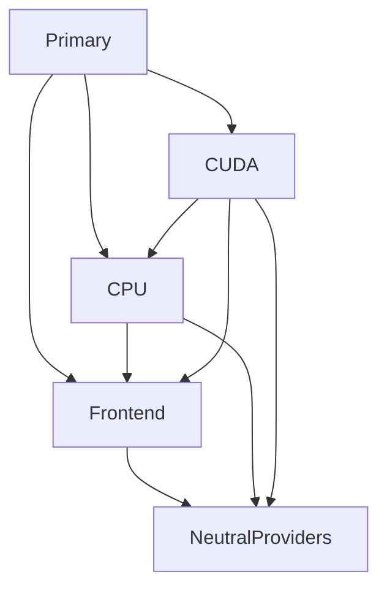

# `stwo_ethereum_statement`

| Fact | Value |
| --- | --- |
| Version | `0.1.0` |
| Layer | `product` |
| Owner | `ethereum-statement` |
| Focused CI host | Linux |

## Purpose and architecture

Ethereum statement orchestration belongs above neutral RISC-V frontends and integrations.
The frontend, CPU and CUDA components are constructed once. CPU imports frontend;
CUDA imports both. The primary module and two legacy exports reuse those instances.
Ethereum request, image, session, publication and recursion policy now live in
this package. Computation, field/curve arithmetic, service ABI and physical
witness storage keep their canonical neutral owners. Strict product placement
is active with zero findings. Whole-package qualification is recorded separately
against immutable source revisions; no GPU qualification is established here.

## Public API

`@import("stwo_ethereum_statement")` exposes `cpu`, `cuda`, `frontend`, `prover`,
`runner` and `statement`. `@import("legacy_riscv_frontend")` and
`@import("legacy_riscv_cpu_integration")` name the exact frontend and CPU component
instances, with no duplicate implementation or nominal records.

## Dependencies

- `stwo_circuit_frontend`
- `stwo_cpu_backend`
- `stwo_metal_backend`

- `stwo_circuit_cpu_integration`
- `stwo_core`
- `stwo_proof_wire`
- `stwo_prover_api`
- `stwo_prover_engine`
- `stwo_riscv_air_lang`
- `stwo_riscv_cpu_integration`
- `stwo_riscv_cuda_integration`
- `stwo_riscv_frontend`
- `stwo_riscv_isa`
- `stwo_riscv_memory`
- `stwo_riscv_precompiles`
- `stwo_riscv_recursion`
- `stwo_riscv_recursion_air`
- `stwo_riscv_rv32`
- `stwo_riscv_rv64`
- `stwo_riscv_testing`

## Build, test, and run

`zig build test --build-file src/products/ethereum/statement/build.zig -Doptimize=Debug -j2`

## Contract and invariants

Keep canonical shared types, profile IDs, protocol bytes, rejection classification,
allocation, cancellation, publication and teardown ordering. Compatibility module
identity is checked in the real build and in concrete primary/legacy consumers.
Legacy aliases are deprecated from 2026-11-09 and retained through at least
2027-02-09 and one subsequent product minor release.

## Change checklist

Migrate all live consumers and discovery roots; activate strict product placement
without exemptions; run frontend Debug/ReleaseFast, CPU negatives and frozen
Native proof-byte parity before calling the extraction complete.

## Related documentation

[RFC #352](https://github.com/teddyjfpender/stwo-zig/issues/352) and
[extraction ledger](../../../../design/repository/ethereum-product-extraction.md).

The primary domain list is deliberately small; it describes ownership rather than
flattening all implementation declarations into a new global surface. The legacy
components preserve the old imported names for migration. Consumers must declare
the real product dependency and bind those names to the corresponding exported
component, rather than compiling the component root again or importing its files
by relative path. Native-only consumers continue using the neutral packages.

The build checks actual component pointers, while the contract tests compare the
module identities and canonical machine, memory, trace and host-interface records.
Those checks are necessary but do not replace execution tests. During extraction,
focused checks are bounded by the laptop memory guard and hold the canonical build
lock. Full combined acceptance is reported separately against its exact source.
No status from the old partial backup establishes acceptance of this package.

Existing CSP qualification commands now belong to this product:
`test-csp-ecdsa-proof`, `test-blake3-csp-ecdsa-jit`, and
`test-blake3-csp-ecdsa-aot` (with the same authenticated bundle option).
The Metal commands are explicit device gates and are outside the default test
step. This migration introduces no device qualification or performance claim.
