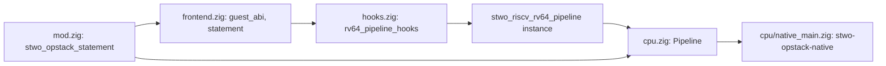

# OP Stack RV64 block statements

Public module `stwo_opstack_statement`.

| Fact | Value |
|---|---|
| Version | `0.1.0` |
| Layer | `product` |
| Owner | `opstack-statement` |
| Focused CI host | Linux |
| Stage | S1 product core (no owner decision needed); S2/S3 wait on RFC-2..RFC-9 |

## Purpose

This package is the OP Stack product line. It proves Kona and Mantle RV64
guest executions of OP Stack blocks on the shared, product-neutral RV64 block
pipeline (`stwo_riscv_rv64_pipeline`). The product owns exactly what is OP
specific: the guest ABI with its 4..32 MiB input window, the 43-byte public
statement and the pipeline hooks that bind them. It imports no other product.

S1 proves the Kona `sha` and `canonical` guest variants with the admitted v3
services ABI (CPU, Keccak, SHA-256, secp256k1, arith256, bulk memory and
sponge). The BN254 sparse-tower packet for the `pairing*` variants is S2 work
(RFC-2, RFC-3); the pure-P2 recursion lanes are S3 work (RFC-5..RFC-9).

## Architecture



## Public API

```zig
const opstack = @import("stwo_opstack_statement");
const output = try opstack.statement.decode(&bytes);
```

- `cpu`: the product's pipeline instance (`cpu.Pipeline`).
- `frontend`: `guest_abi` (symbols, window rules, `load`) and `statement`.
- `hooks`: the OP implementation of the pipeline hooks.
- `statement`: decode, encode and bind the 43-byte output
  `digest[32] || version 1 || chain_id u64 LE || schema` (`OP` execution,
  `OD` anchored derivation).

## Dependencies

- `stwo_riscv_rv64_pipeline`: the shared block pipeline and its BUILD-only
  `instantiate`.
- `stwo_riscv_cpu_integration`: declared closure of the pipeline instance.
- `stwo_riscv_frontend`: build-time test count floors.
- `stwo_riscv_rv64`: ELF loading and execution profiles.

## Build, test, and run

```sh
zig build test --build-file src/products/opstack/statement/build.zig -Doptimize=Debug -j2 --verbose --summary all
zig build test-e2e-probe --build-file src/products/opstack/statement/build.zig -Doptimize=ReleaseFast -j2 --verbose --summary all
zig build opstack-native --build-file src/products/opstack/statement/build.zig -Doptimize=ReleaseFast
```

`opstack-native` installs `stwo-opstack-native`. `cpu/cli.zig` maps its
command surface onto the pipeline: `prove` → `produce-candidate`, `verify` →
`verify-candidate`, `plan-candidate` → `plan`; flags may follow the positional
arguments. `batch-candidate`, `verify-batch-candidate`, `execute`, a
non-default `--gkr-storage` and a non-committed `--receiver-setup` exit with a
named error until the S2 RFCs land. The receiver runs in a separate process
with no setup directory. Fixture paths reach `test-e2e-probe` through the
`opstack_fixture_paths` build options module, never through the environment.

`test-e2e-probe` also runs `tests/e2e_probe_prove.zig`: it proves the golden
probe with `stwo-opstack-native prove`, receives it with `verify` in a fresh
process, and requires three corruptions to be rejected (a flipped proof byte,
the same byte with a rehashed bundle manifest, and a different expected
output). Every pipeline call is a child process, so its JSON reports never
reach the test runner's stdout.

## Contract and invariants

- The input window is a power of two in 4..32 MiB; 64 MiB is rejected.
- Only `ethereum_services_v3` (the v3 services ABI) is admitted in S1. Any
  other profile fails request admission before a file is read.
- `service_families` is empty, so proofs use the pipeline's base roster.
- The hooks label `opstack` never enters a transcript or digest.
- Statement decoding is strict: unknown versions or schemas are rejected.

## Change checklist

- Keep OP behaviour here, never in `src/frontends/**` or `src/integrations/**`.
- Shared-code needs go through an RFC and land neutrally named.
- New `STWO_*` environment names are not admitted; use CLI arguments.
- Update the contract budget and the `opstack_s1_statement` budget entry.

## Related documentation

- [Restructure plan](../../../../design/repository/restructure-plan.md)
- [Engineering standards](../../../../ENGINEERING_STANDARDS.md)
- [Pipeline package](../../../integrations/riscv_cpu/rv64_pipeline/README.md)
