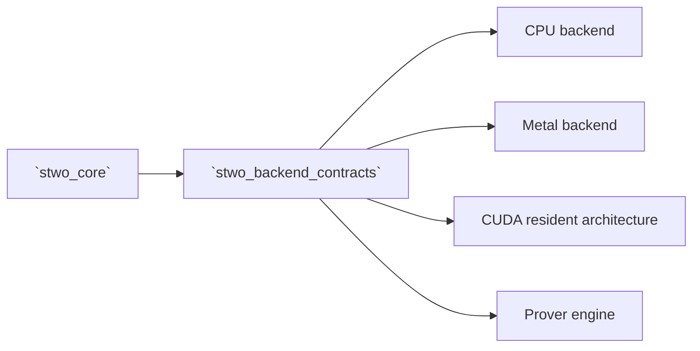

# `stwo_backend_contracts`

`stwo_backend_contracts` defines the compile-time capabilities that prover
implementations may request from a compute backend. It is the abstraction
boundary between proof orchestration and CPU, Metal, or other backend
implementations; it contains contracts, not a working backend.

| Property | Value |
| :--- | :--- |
| Version | `1.0.0-rc.5` |
| Layer | `contract` |
| Owner | `backend-contracts` |
| Public Zig module | `stwo_backend_contracts` |
| Focused CI host | Linux |

See the [package contract](package.contract.json) for the exact dependency and
API ledger and [mod.zig](mod.zig) for the public facade.

## Purpose and boundaries

The package makes backend claims explicit and compile-time checked:

- every backend declares column storage and a `Capabilities` value;
- required proof paths validate the typed Merkle contract;
- optional host batch inversion and backend FRI folding are opt-in;
- claiming an optimization validates its concrete function signature; and
- not claiming an optimization requires the corresponding operation to be
  absent, preventing placeholders from masquerading as capabilities.

It does not implement CPU arithmetic, initialize a GPU runtime, or orchestrate
a proof. Concrete work lives in backend packages and
`stwo_prover_engine`.



## Public API

```zig
const contracts = @import("stwo_backend_contracts");
const cpu = @import("stwo_cpu_backend");

comptime {
    contracts.assertBackend(cpu.CpuBackend);
}
```

| Area | Exports |
| :--- | :--- |
| Top-level checks | `assertBackend`, `assertBackendForChannel` |
| Core types | `Capabilities`, `Column` |
| Storage contracts | `column`, `resident_storage`, `secure_column`, `arena_plan` |
| Operation contracts | `field_ops`, `fri_ops`, `line_evaluation`, `merkle_ops`, `recovery` |
| Proof-program contract | `proof_program` |
| Capability definitions | `capabilities` |
| Arena-origin diagnostics | `error_codes` |

Use `assertBackend` for the minimum backend contract and
`assertBackendForChannel` when a proof path also needs a typed Merkle hasher and
channel combination. Both execute at compile time.

## Dependencies

The only first-party dependency is:

- `stwo_core` — shared field, proof, PCS, and commitment types used in
  signatures.

The package must never depend on a concrete backend or the prover engine.

## Build, test, and run

From the repository root:

```sh
zig build test --build-file src/waist/backend/build.zig -Doptimize=ReleaseFast -j2
```

This is a contract library and has no executable. To exercise it, compile a
concrete backend package or a product that instantiates the prover engine.

## Contract and invariants

The focused contract anchors are:

- API signature: a truthful minimum capability set is accepted.
- Behavioral invariant: the Native AIR proof-program contract rejects
  unbound or internally inconsistent ingress.

Tests should cover both sides of capability admission. A new capability is not
complete until a valid implementation compiles and missing, misspelled, or
incorrectly typed implementations fail at compile time.

## Change checklist

1. Treat capability changes as public API changes.
2. Keep optional operations absent when their capability bit is false.
3. Test positive and negative compile-time shapes.
4. Update every affected backend contract and its package API ledger.
5. Run this package test plus `python3 scripts/repo/check_package_workspace.py`.

## Related documentation

- [Backend capability implementation audit](../../../design/decisions/2026-07-28-zig-package-workspace-release-audit.md)
- [Protocol core package](../core/README.md)
- [Stable prover API](../prover_api/README.md)
- [Prover engine](../../engine/prover/README.md)
- [Package release policy](../../../design/repository/zig-package-release-policy.md)


## Consumer-owned provider checks

The scalar CPU backend registers checked Native trace geometry and its actual `CpuBackend` conformance witness. The provider contract also registers its Core dependency laws where applicable.

The existing aggregate package graph exposes `zig build test-cdc-stwo-backend-contracts -Doptimize=Debug -j2` and the same command with `ReleaseFast`. Both commands are appended to the existing provider lane; the original package commands remain required. Each registered root uses the actual consumer's canonical provider module, executes its named cases, and rejects missing or duplicate discovery. These registrations are a bounded subset of the live consumer graph; they do not establish full [D3 coverage](https://github.com/teddyjfpender/stwo-zig/issues/366).

The typed `error_codes.fromArena` accepts only arena-plan errors and allocator failure from that boundary. Codes `0x2001`–`0x200d` are diagnostic metadata; original errors, plan hashes and proof bytes are unchanged. The Metal arena-plan process emits these only from its typed `arena_plan.build` catch. Foreign and unknown lookup codes return null.


Optional `proof_program.ProofProgram.validateDiagnosed` records exact owned
program/Native AIR admission codes without changing the primary rejection.
Native contract detail accompanies the released `InvalidNativeAir` wrapper;
program-level mismatch remains a program origin. The literal `error_codes`
table reserves `0x2201`–`0x2210` and `0x2301`–`0x2306`; these are typed origins,
not a classifier for arbitrary same-named caller errors.

### Recovery diagnostics

The optional per-call diagnosed registry, spill and engine operations assign
codes only at explicit owned return sites. They retain no output pointer and
preserve ordinary error-set members. Recipe/buffer/group callbacks, allocator
failures and file I/O retain separate provenance, even with matching error tags.

| Code | Owned cause | Retry rule |
|---|---|---|
|0x2401|DuplicateRecipe|Fix the registry; failed admission frees its private copy.|
|0x2402|MissingRecipe|Fix the registry or plan before retry.|
|0x2403|MissingSpillEntry|Fix the spill plan before retry.|
|0x2404|SpillNotMaterialized|Materialize the binding before retry.|
|0x2405|SpillCorrupted|Discard destination contents; rematerialize from authority.|
|0x2406|BindingSizeMismatch|Fix sizes before retry; admission precedes I/O/callbacks.|

A failed restore may have modified destination bytes; no automatic replay is
performed. The existing checksum detects corruption and is not a cryptographic
authentication claim. File ownership transfers only on successful initialization.
Empty recipe registries are valid for resident-only plans. Actual temporary-file
and Cairo-recipe tests exercise these operations; full device-hook campaigns
remain separate. Version rc.4 adds these nested optional methods and meanings.

### Scalar ownership and retry

The scalar `line_evaluation` and `secure_column` libraries retain their typed
error sets. These library errors are not serialized diagnostic codes.
Constructors adopt caller buffers or resident storage only on success; rejected
lengths leave caller ownership intact and do not destroy a resident handle.

| Operation | Failure and retry contract |
|---|---|
| Allocating construction, cloning and conversion | OOM leaves the source and its ownership unchanged; retry with an allocator that can satisfy the request. |
| Line interpolation with inconsistent length | Reject before allocation or mutation; correct the length/domain relationship before retry. |
| Borrowed/resident interpolation | Source values and resident storage remain owned by the source on success or failure; temporary coefficients are released on failure. The returned polynomial owns independent host storage. |
| Owned in-place interpolation | Success transfers values to the polynomial. A later arithmetic error may mutate values: discard them rather than assuming an unchanged retry. |

Public line-domain fields must preserve their initialized invariants. The
malformed-domain tests deliberately violate that precondition to exercise
existing error cleanup; they are not examples of valid proof inputs.
`scalar_ownership_test.zig` executes six registered invariant families for
QM31 and OM31, including actual allocation refusal, corrected retries and
exactly-once destruction of counted host resident handles. The original full
package test passes 39 cases in each optimization profile. These host storage
checks do not claim device execution or whole-proof qualification.
