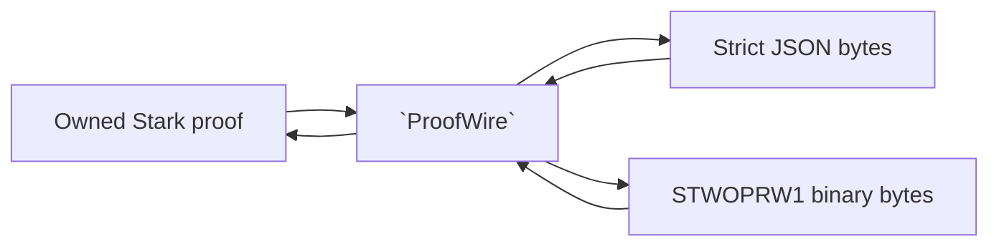

# `stwo_proof_wire`

`stwo_proof_wire` maps the canonical lifted Blake2s STARK proof to a
cross-language JSON shape and to a compact versioned binary representation. It
owns proof encoding and reconstruction, not statement framing or proof
verification policy.

| Property | Value |
| :--- | :--- |
| Version | `1.0.0-rc.2` |
| Layer | `interchange` |
| Owner | `proof-wire` |
| Public Zig module | `stwo_proof_wire` |
| Focused CI host | Linux |
| Upstream proof shape | raw Stwo `a8fcf4bd` |

The [package contract](package.contract.json) and [public facade](mod.zig) are
the authoritative API records.

## Purpose and boundaries



The default API preserves the historical QM31 JSON and `STWOPRW1` binary bytes.
Use `ForField(core.fields.om31.OM31)` explicitly for eight-coordinate proofs.
That codec requires `STWOPRW8` in binary and the
`{ "protocol": "stwo-om31-proof-v1", "proof": ... }` envelope in JSON. Each
secure value has exactly eight canonical M31 coordinates, including the upper
half. Cross-field binary headers and JSON envelopes are rejected.

Both decoders reject unknown fields, non-canonical coordinates, truncation,
trailing binary bytes, and out-of-range values. Binary vector counts are
checked against the remaining bytes before allocation, using the selected
field's encoded element size.

This package does **not** bind a proof to an application statement, choose
security parameters, run the verifier, or provide the fixed-memory preflight
used for hostile artifact admission. Callers handling untrusted files must use
the product's framing, size limits, statement checks, and verifier policy in
addition to this codec.

## Public API

```zig
const wire = @import("stwo_proof_wire");

const json_bytes = try wire.encodeProofBytes(allocator, proof);
defer allocator.free(json_bytes);

var decoded = try wire.decodeProofBytes(allocator, json_bytes);
defer decoded.deinit(allocator);
```

| Area | Exports |
| :--- | :--- |
| Explicit field/family selection | `ForField` (QM31 or OM31), `ForHasher` |
| Concrete proof identity | `Hasher`, `Proof` |
| Wire shape | `ProofWire`, `PcsConfigWire`, `FriConfigWire`, `FriProofWire`, `FriLayerWire`, `MerkleDecommitmentWire` |
| Scalar encodings | `HashWire`, `Qm31Wire` |
| JSON codec | `encodeProofBytes`, `encodeProofHexAlloc`, `decodeProofBytes` |
| Binary codec | `encodeProofBytesBinary`, `decodeProofBytesBinary` |
| Shape conversion | `proofToWire`, `wireToProof`, `wireToProofFor` |
| Errors | `CodecError` |

All decode functions return an independently owned `Proof`. The caller must
deinitialize it with the same allocator. `ProofWire` contains borrowed or
allocator-owned slices according to how it was constructed; prefer the
high-level byte codecs unless direct shape access is required.

`ForHasher(Secure, HashFamily)` qualifies QM31 and OM31 with the existing
lifted prefixed Blake2s, Poseidon2 M31 v1 and Poseidon2 M31 v2 families.
Other thirty-two-byte representations have no qualification from these tests.

| Family | QM31 binary header | OM31 binary header |
| --- | --- | --- |
| Default lifted Blake2s | `STWOPRW1` | `STWOPRW8` |
| Poseidon2 M31 v1 | `STP2QW01` | `STP2OW01` |
| Poseidon2 M31 v2 | `STP2QW02` | `STP2OW02` |

Existing JSON envelopes and protocol strings remain exact; default QM31 JSON
remains unenveloped. `wireToProofFor(TargetHasher, allocator, wire)` reconstructs
an independently owned proof when the target hash representation matches.
The caller derives that target from trusted verifier policy: representation
compatibility does not authenticate an algorithm. Inputs remain borrowed and
immutable, partial allocations are released on failure, and successful proof
ownership ends with `deinit(allocator)`. Allocation failure permits a retry with
resources; malformed/noncanonical input needs correction. Existing error tags
and rejection meanings remain unchanged.

## Dependencies

- `stwo_core` — proof, PCS, FRI, field, and lifted Merkle types.

No prover, backend, frontend, or integration package is allowed in this
interchange layer.

## Build, test, and run

From the repository root:

```sh
zig build test --build-file src/waist/proof_wire/build.zig -Doptimize=ReleaseFast -j2
```

This is a codec library and has no standalone command. The repository
interoperability CLI is an assembled consumer:

```sh
zig build interop-cli -Doptimize=ReleaseFast
```

See the [repository README](../../../README.md) for product-level prove and
verify commands, which include statement and policy checks absent here.

## Contract and invariants

- API signature: byte codecs preserve owned byte/proof result contracts.
- Explicit-family signatures pin selected proof types for all six combinations.
- Family framing, all coordinates, immutable inputs and every allocation-failure
  point are exercised by provider tests in Debug and ReleaseFast.
- Behavioral invariant: the binary decoder rejects every truncation and wrong
  version exercised by the corpus.

Any wire-shape change must consider canonical encoding, cross-language
compatibility, allocation limits, wrong-statement handling, and downgrade
behavior. Do not silently reinterpret a prior binary version.

## Change checklist

1. Preserve strict JSON field handling and canonical field decoding.
2. Version binary changes rather than changing `STWOPRW1` semantics in place.
3. Add round-trip plus truncation, mutation, trailing-byte, and wrong-version
   tests.
4. Confirm product-level framing and independent verifier consumers.
5. Run this package test, protocol interchange tests, and the release gate.

## Related documentation

- [Protocol core](../core/README.md)
- [Repository artifact and CLI overview](../../../README.md)
- [Package-workspace audit](../../../design/decisions/2026-07-28-zig-package-workspace-release-audit.md)
- [Package release policy](../../../design/repository/zig-package-release-policy.md)

Approved contract transaction: [RFC #325](https://github.com/teddyjfpender/stwo-zig/issues/325).
No production codec implementation, proof bytes or protocol revisions changed.


## Consumer-owned provider checks

Native examples register malformed binary framing in both supported fields, with a zero-allocation admission budget. The provider contract also registers its Core dependency laws where applicable.

The existing aggregate package graph exposes `zig build test-cdc-stwo-proof-wire -Doptimize=Debug -j2` and the same command with `ReleaseFast`. Both commands are appended to the existing provider lane; the original package commands remain required. Each registered root uses the actual consumer's canonical provider module, executes its named cases, and rejects missing or duplicate discovery. These registrations are a bounded subset of the live consumer graph; they do not establish full [D3 coverage](https://github.com/teddyjfpender/stwo-zig/issues/366).

## Origin-specific decode diagnostics

`decodeProofBytesWithDiagnostic` and `decodeProofBytesBinaryWithDiagnostic`
retain the existing decoder error/ownership behavior and accept an optional
`?*?core.error_codes.Entry`. They clear that output on entry, including on
success. The five existing `CodecError` tags carry these append-only meanings:

| Code | Tag | Class |
| --- | --- | --- |
| `0x4001` | `NonCanonicalM31` | `invalid_input` |
| `0x4002` | `ValueOutOfRange` | `invalid_input` |
| `0x4003` | `InvalidBinaryProof` | `invalid_input` |
| `0x4004` | `UnsupportedBinaryVersion` | `unsupported` |
| `0x4005` | `NonCanonicalPoseidonDigest` | `invalid_input` |

All are introduced in `1.0.0-rc.2`. `error_codes.fromCodec` takes only the owned
`CodecError` set. The `error_codes` namespace owns this table and lookup.
`lookup` returns null for unknown or foreign-provider codes.
Parser, configuration and allocation errors are propagated without fabricated
metadata. No code is a proof verdict, retry authorization, or global error-name
mapping. Retrying unchanged invalid bytes is not useful; allocation failure
retains the caller's existing resource policy. Decoder calls borrow input,
return independently owned proofs, and publish no proof on failure.

The Native interop verifier uses the JSON diagnostic entrypoint and emits a
bounded best-effort `proof_wire_decode_rejection_v1` stderr line for a mapped
rejection. It rethrows the original error, preserving stdout and process exit
behavior; failure to write the optional line cannot replace that error. Existing
entrypoints remain compatible. Other providers and parser-origin error ledgers
remain open under [D2](https://github.com/teddyjfpender/stwo-zig/issues/359).
